<!--
  ====================================================================
  PROFILE README v2  -  CHEMISTRY x GAME
  ====================================================================
  Các ảnh trong ./profile/ do GitHub Actions tự tạo (xem
  .github/workflows/profile.yml và scripts/make_assets.py).

  CẦN SỬA:
    1) Ctrl+F (Mac: Cmd+F) tìm "YOUR_" và thay bằng thông tin thật
       (email, Facebook, Telegram). Dòng nào không dùng thì xoá luôn.
    2) Đổi tên / chỉ số / kỹ năng trên các thẻ game: sửa phần CẤU HÌNH
       ở đầu file scripts/make_assets.py rồi commit.
    3) Khối chú thích này không hiển thị ra ngoài, xoá hay giữ đều được.
  ====================================================================
-->

<!-- 1. BANNER (tự vẽ, có hiệu ứng động) -->

  

<!-- 2. LIÊN HỆ (shields.io). Xoá dòng nào bạn không dùng. -->

  
  

<!-- 3. GIỚI THIỆU NGẮN: viết lại bằng giọng của bạn (tiếng Việt cũng được) -->

  <b>Hi, I'm Nguyen Le Mai Anh</b> 👋 
  An aspiring <b>chemistry &amp; chemical engineering</b> student who loves mixing molecules with code. 
  Currently building <a href="https://nglemaianh.github.io">my website</a> and levelling up one commit at a time 🧪

<!-- 4. THẺ NHÂN VẬT + CÂY KỸ NĂNG (tự vẽ, chỉnh trong scripts/make_assets.py) -->

  

  

<!-- 5. THỐNG KÊ GITHUB (GitHub Actions tạo, cập nhật mỗi 6 tiếng) -->

  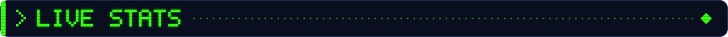

  
  

  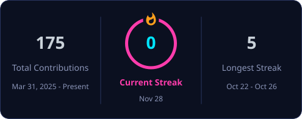

<!-- 6. CON RẮN ĂN CONTRIBUTION (Platane/snk, thêm nền tối bằng script) -->

  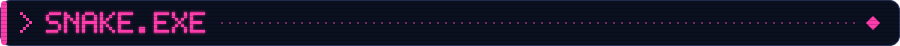

  

<!-- 7. QUEST LOG: tick [x] khi xong một nhiệm vụ, thêm dòng mới tuỳ thích -->

  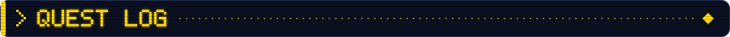

- [x] 🎮 Create my GitHub profile - *Level 1 unlocked!*
- [x] 🌐 Launch my personal website
- [ ] 🐍 Learn Python basics for chemistry (data, plots, simulations)
- [ ] ⚗️ Build a molar mass calculator
- [ ] 📈 Plot a titration curve with Python
- [ ] 🧪 Publish my chemistry study notes
- [ ] 🏭 Try a process simulator (Aspen Plus or the free DWSIM)

<!-- 8. DỰ ÁN NỔI BẬT: thêm dự án mới thì thêm 1 dòng vào bảng -->

  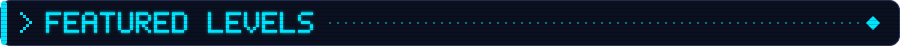

| Level | What it is | Tech |
| --- | --- | --- |
| [nglemaianh.github.io](https://github.com/nglemaianh/nglemaianh.github.io) | My personal website | `HTML` |
| 🔒 *Level 2* | Molar mass calculator *(coming soon)* | `Python` |

<!-- 9. FOOTER -->

  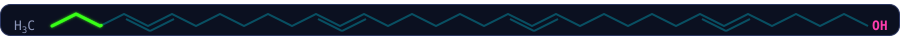

  

Thanks for stopping by! Star a repo of mine to give me +10 XP ⭐

