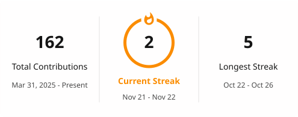

<!--
  ==================================================================
  PROFILE README - BẢN MẪU
  ==================================================================
  CÁCH DÙNG NHANH
  1) Bấm Ctrl+F, tìm chữ "YOUR_" và thay bằng thông tin thật của bạn:
       YOUR_NAME, YOUR_USERNAME, YOUR_EMAIL, YOUR_LINKEDIN,
       YOUR_FACEBOOK, YOUR_TELEGRAM, YOUR_PROJECT, YOUR_TOPIC ...
  2) Các ảnh ./profile/*.svg do workflow tự tạo (file
     .github/workflows/profile.yml). Trước lần chạy đầu tiên chúng sẽ
     hiện ảnh vỡ - đó là bình thường.
  3) Khối chú thích này không hiển thị ra ngoài, xoá hay giữ đều được.
  ==================================================================
-->

<!-- 1. BANNER (capsule-render). Tự thiết kế kiểu khác tại https://capsule-render.vercel.app
     Tên có dấu cách thì viết %20, ví dụ: An%20Nguyen -->

  

<!-- 2. DÒNG CHỮ TỰ GÕ (readme-typing-svg).
     Gõ chữ của bạn trực tiếp tại https://readme-typing-svg.demolab.com/demo/
     rồi copy link nó tạo ra (nó tự mã hoá tiếng Việt có dấu giúp bạn).
     Các dòng ngăn cách nhau bằng dấu ; và dấu cách viết là + -->

  

<!-- 3. LIÊN HỆ (shields.io).
     LinkedIn không có logo vì Simple Icons đã gỡ logo này, nên để badge chữ.
     Xoá dòng nào bạn không dùng. -->

  
  
 

## 👋 About me

- 🔭 Currently working on **YOUR_PROJECT**
- 🌱 Currently learning **YOUR_TOPIC**
- 💬 Ask me about **YOUR_SKILL**
- 🎯 Looking for **internships / collaborations / open-source projects**
- ⚡ Fun fact: **YOUR_FUN_FACT**

<!-- 4. KỸ NĂNG (skillicons.dev).
     Đổi danh sách sau i= (cách nhau bằng dấu phẩy). Tra mã icon tại
     https://github.com/tandpfun/skill-icons#icons-list
     perline = số icon trên mỗi hàng. -->
## 🛠️ Tech stack

<!-- 5. THỐNG KÊ GITHUB - ảnh do workflow tạo trong ./profile/
     Mỗi ảnh có bản sáng + tối, GitHub tự chọn theo giao diện người xem. -->
## 📊 GitHub stats

  <picture>
    <source media="(prefers-color-scheme: dark)" srcset="./profile/stats-dark.svg">
    
  </picture>
  <picture>
    <source media="(prefers-color-scheme: dark)" srcset="./profile/top-langs-dark.svg">
    
  </picture>

  <picture>
    <source media="(prefers-color-scheme: dark)" srcset="./profile/streak-dark.svg">
    
  </picture>

<!-- 6. CON RẮN ĂN CONTRIBUTION (Platane/snk) - ảnh do workflow tạo -->
## 🐍 Contribution snake

  <picture>
    <source media="(prefers-color-scheme: dark)" srcset="./profile/snake-dark.svg">
    
  </picture>

<!-- 7. DỰ ÁN NỔI BẬT. Chưa có dự án thì xoá cả mục này (từ dòng ## đến hết bảng). -->
## 🚀 Featured projects

| Project | What it does | Tech |
| --- | --- | --- |
| [project-one](https://nglemaianh.github.io) | Personal Portfolio | `JavaScript` `HTML5` |

 

<!-- 8. ĐẾM LƯỢT XEM PROFILE (komarev.com) + FOOTER -->

  

<i>Thanks for stopping by! ⭐ A star on my repos always makes my day.</i>

